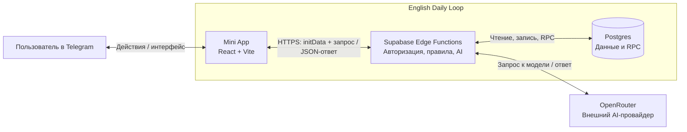
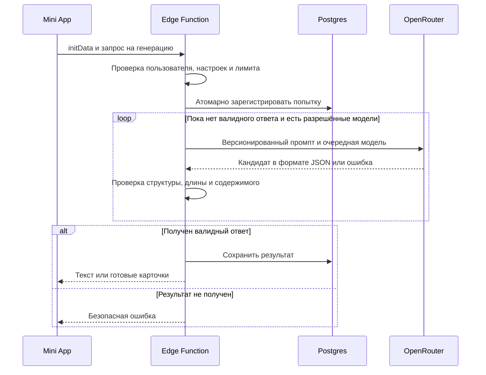

# English Daily Loop

Telegram Mini App для ежедневной практики английского: короткое чтение по своему уровню, личный словарь и повторение слов. Пользователь выбирает уровень и длительность чтения, получает текст, сохраняет незнакомые слова и возвращается к ним в следующих занятиях.

**Статус:** MVP. Приложение работает внутри Telegram; оплата подписки и редактирование AI-карточек пока не открыты в пользовательском интерфейсе.

## Возможности пользователя

- **Настроить занятие:** выбрать уровень английского от A1 до B2 и время чтения: 3, 5, 10 или 15 минут.
- **Читать:** получить текст под свои настройки, вернуться к незавершённому тексту и посмотреть историю прочитанного.
- **Собирать словарь:** сохранить незнакомое слово из текста и позже подготовить для него карточку с переводом и примерами.
- **Повторять слова:** проходить дневную очередь карточек и видеть прогресс чтения и повторения на главной.
- **Сообщить о проблеме:** отправить отчёт об ошибке из настроек приложения.

## Архитектура

Mini App открывается внутри Telegram и показывает состояние пользователя. Edge Functions проверяют initData, лимиты и права доступа; Postgres хранит данные, а OpenRouter используется только для AI-генерации. Стрелки показывают обмен запросами и ответами между основными компонентами.

Команды бота обслуживает отдельная Edge Function telegram-bot-webhook. Этот вход не участвует в запросах чтения и словаря.

| Слой | Ответственность | Где смотреть |
| --- | --- | --- |
| Интерфейс | Экраны, компоненты и локальное состояние | [`src/screens`](src/screens), [`src/components`](src/components), [`src/hooks`](src/hooks) |
| Клиентские сервисы | Контракты запросов к Edge Functions и обработка ошибок | [`src/services`](src/services) |
| Сервер | Telegram `initData`, правила доступа, лимиты, AI и сохранение данных | [`supabase/functions`](supabase/functions) |
| Данные | Схема Postgres, ограничения доступа и транзакционные операции | [`supabase/migrations`](supabase/migrations) |

Прямой доступ клиентских ролей к защищённым таблицам и RPC закрыт через RLS и grants. Edge Functions проверяют `initData` и выполняют чувствительные операции на сервере. Подробнее: [границы доступа](notes/server-side-data-guards.md).

Для первого production-развёртывания выбрана схема: статический frontend на Vercel, Edge Functions и Postgres в Supabase Cloud, AI-запросы через OpenRouter. [Почему выбрана эта архитектура](notes/deployment-platform-decision.md).

### Как работает AI в запросе на генерацию

Схема ниже показывает путь запросов, в которых участвует AI: Mini App обращается к Edge Function, сервер проверяет пользователя и лимит, вызывает OpenRouter, проверяет ответ и только затем сохраняет результат. Это относится к генерации текста для чтения и подготовке словарных карточек. Промпты хранятся рядом с серверной логикой и имеют версии; ключ OpenRouter хранится отдельно в серверном окружении.

Модель предлагает результат, но не принимает решения о доступе и не сохраняет данные напрямую. Сервер проверяет ответ до записи в БД; для текста сохраняет только валидный результат, а при неудаче оставляет прежний активный текст доступным. В диагностике фиксируются версия промпта, модель и безопасные технические метаданные без полного промпта и исходного ответа провайдера.

Код сценариев: [генерация текста](supabase/functions/generate-reading-text), [подготовка карточек](supabase/functions/prepare-vocabulary-cards). Подробности: [пайплайн генерации](notes/text-generation-pipeline.md), [AI-безопасность](notes/ai-pipeline-security.md), [словарь](notes/vocabulary-save-flow.md).

## Технологии

| Область | Инструменты |
| --- | --- |
| Интерфейс | React, TypeScript, Vite, Tailwind CSS, Telegram Mini Apps |
| Сервер и данные | Supabase Edge Functions, Deno, Postgres, SQL migrations, RLS |
| AI | OpenRouter, версионированные промпты, проверка ответов и fallback между разрешёнными моделями |
| Разработка | pnpm, локальный Supabase в Docker, Cloudflare Tunnel для запуска внутри Telegram |
| Качество | TypeScript, ESLint, Prettier, Stylelint, Node test runner, Vitest, Playwright, Deno tests |

Серверные секреты не входят в frontend bundle. В `VITE_*` находятся только публичные параметры клиента; ключи Telegram и OpenRouter задаются для Edge Functions. [Состав окружения](notes/production-env.md).

## Разработка по спецификациям

Рефакторинг версии 1.1 вёлся по SDD (Specification-Driven Development). Для каждой согласованной части сначала фиксировались цель, границы и критерии приёмки, затем готовились спецификация, план и задачи. Перед кодом документы проверялись на противоречия; после реализации результаты команд и оставшиеся ограничения записывались отдельно. AI-агент помогал готовить технические документы и реализовывать согласованные шаги; ключевые решения и приёмка оставались за мной.

В репозитории можно проследить процесс на [F16: отчёты об ошибках](specs/017-f16-support-diagnostics): [спецификация](specs/017-f16-support-diagnostics/spec.md), [план](specs/017-f16-support-diagnostics/plan.md), [задачи](specs/017-f16-support-diagnostics/tasks.md), [анализ](specs/017-f16-support-diagnostics/analysis.md) и [проверка](specs/017-f16-support-diagnostics/verification.md). Общие принципы проекта находятся в [constitution](.specify/memory/constitution.md).

## Проверки

[GitHub Actions](.github/workflows/quality.yml) запускает проверки типов, линтеры и форматирование, тесты, проверку Edge Functions и сборку. Наборы решают разные задачи:

| Проверка | Что проверяет |
| --- | --- |
| `pnpm typecheck` | Типы frontend и TypeScript-кода репозитория |
| `pnpm lint`, `pnpm format:check`, `pnpm lint:styles` | ESLint, Prettier и CSS-правила |
| `pnpm test` | Контракты, доменную логику и React-компоненты через Node test runner и Vitest |
| `pnpm test:e2e` | Пользовательские сценарии в браузере через Playwright |
| `pnpm test:edge` | Типы, lint и тесты серверных Edge Functions через Deno |
| `pnpm build` | Production-сборку frontend |

Для исторических файлов действует [baseline проверок](scripts/quality/quality-baseline.json): новые и изменённые файлы проходят актуальные правила, а замечания в части неизменённых файлов остаются техническим долгом. Результаты по каждой части рефакторинга зафиксированы в её `verification.md`. Это не утверждение о полном покрытии кода тестами.

## Документация

- [Дизайн-система](docs/DESIGN_SYSTEM.md)
- [Словарь и подготовка карточек](notes/vocabulary-save-flow.md)
- [Алгоритм повторения](notes/vocabulary-review.md)
- [Отчёты об ошибках](notes/support-diagnostics.md)
- [План первого production-развёртывания](notes/production-deploy-flow.md)
- [Модель угроз](notes/security-threat-model.md)
